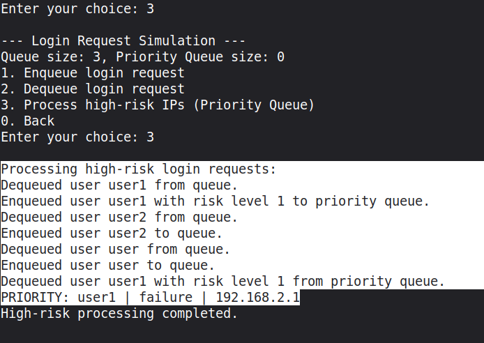
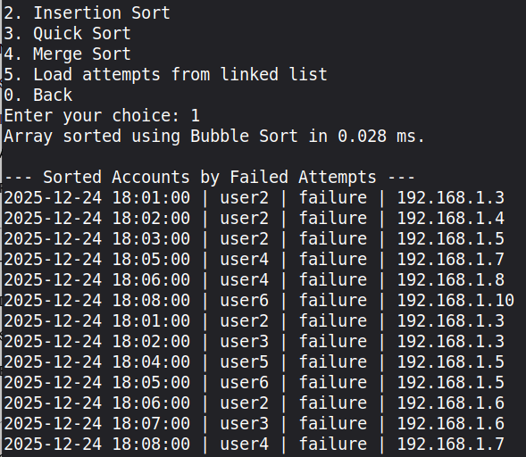
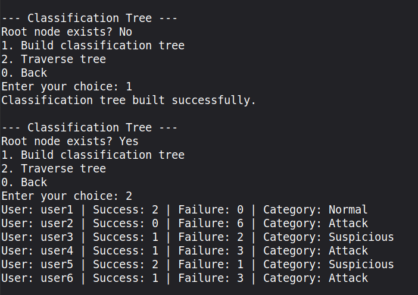
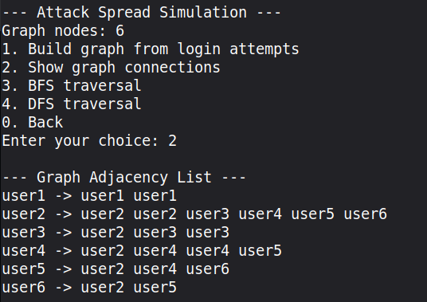

<div align="center">

# Malicious Login Detector

Detecting brute-force and credential-stuffing attempts in login logs with data structures written from scratch in C.


<sub>Semester project · Advanced Algorithmics · EIDIA, Euro-Mediterranean University of Fes · December 2025</sub>

[Modules](#modules) &nbsp;·&nbsp; [Screenshots](#screenshots) &nbsp;·&nbsp; [Report](Report.pdf)

</div>

## Overview

The program reads login attempts (timestamp, username, IP address, success or failure) and runs them through one module per data structure: storing the records, spotting repeated failures, prioritizing risky IPs, searching a blacklist, ranking accounts, classifying users and tracing how one IP spreads across accounts. The project also compares the time and space complexity of each approach.

> [!NOTE]
> This repository holds the module interfaces (`include/`) and the final [report](Report.pdf) with the design, complexity analysis and results. The `.c` files in `src/` are empty placeholders here.

## Modules

| Data structure | Module | Purpose |
|---|---|---|
| Array list, linked list | Record storage | Store login attempts and compare insertion, deletion and traversal |
| Stack | Suspicious user tracker | Flag a user after *k* failures in a row |
| Queue, priority queue | Request simulation | Process incoming logins in order, high-risk IPs first |
| Linear and binary search | Blacklist | Check usernames and IPs against a blacklist |
| Bubble, insertion, quick and merge sort | Ranking | Rank accounts by failed attempts and time each algorithm |
| Tree | Classification | Sort users into Normal, Suspicious and Attack |
| Graph with BFS and DFS | Attack spread | Link accounts tried from the same IP and trace the spread |

All modules share one record type:

```c
typedef struct {
    char timestamp[20];
    char username[32];
    char ip[16];
    int success;   // 1 = success, 0 = failure
} LoginRecord;
```

## Screenshots

<sub>Program output, taken from the project report.</sub>

<table>
  <tr>
    <td width="50%"><p align="center"><b>High-risk IPs processed first</b></p></td>
    <td width="50%"><p align="center"><b>Accounts ranked by failed attempts</b></p></td>
  </tr>
  <tr>
    <td><p align="center"><b>Users classified as Normal, Suspicious or Attack</b></p></td>
    <td><p align="center"><b>Accounts linked by shared IPs</b></p></td>
  </tr>
</table>

## Project structure

```
malicious-login-detector/
├── include/        # One header per module, with the function contracts
├── src/            # Module sources and main.c
├── setup.sh        # Creates the project skeleton
└── Report.pdf      # Design, complexity analysis and results
```

## Team

Yassine Aitaouicha, Marwa El Khoudari, Adam Khlifi Taghzouti, Malak Boulahbach, Hamza El Mourabit and Haytam Hannoun.

## License

Released under the [MIT License](LICENSE).

---

<div align="center"><sub>Part of <a href="https://github.com/creepout777">Yassine Aitaouicha's projects</a></sub></div>
